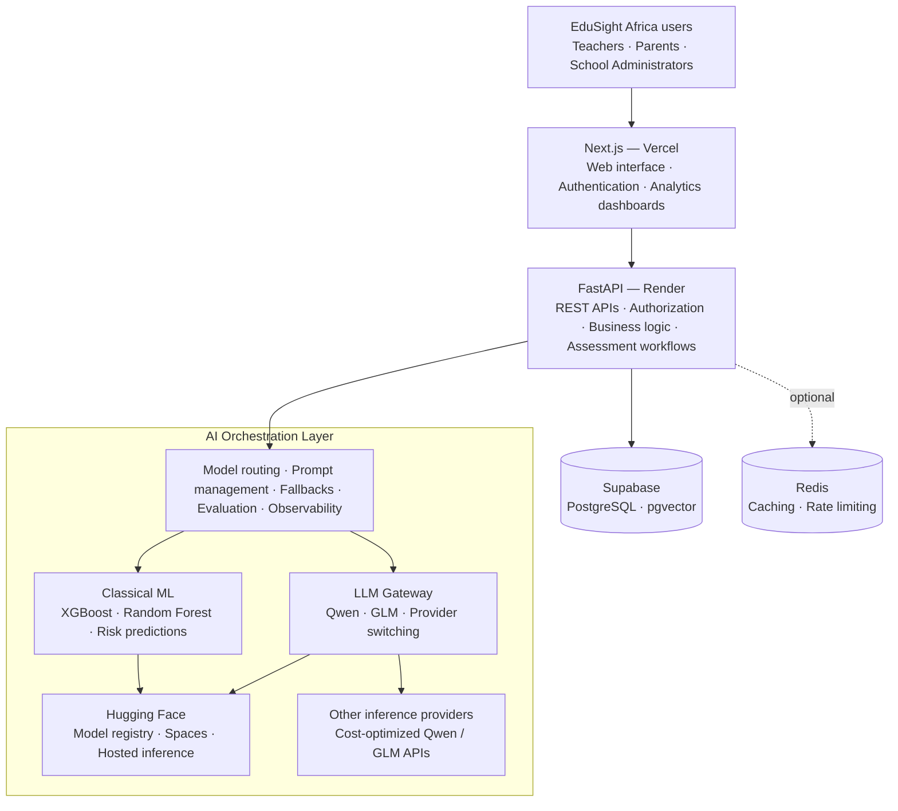
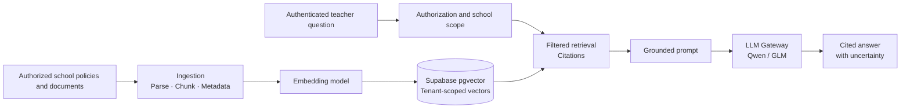
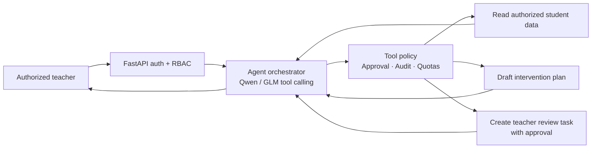
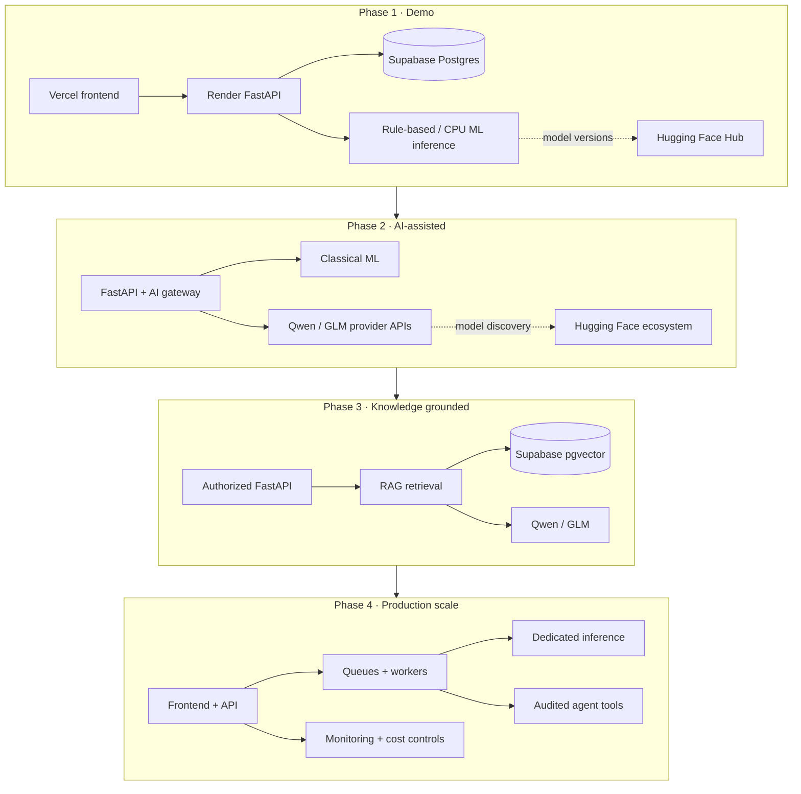

# EduSight Africa — AI-Ready Deployment and Scaling Plan

> Proposed future-state architecture, not a statement of what is deployed. Keep Hugging Face central to model management while supporting cost-efficient Qwen and GLM inference through interchangeable providers.

## 1. Revised architecture

The following diagram reproduces the previously agreed components and connections in GitHub-renderable Mermaid.



Start with AI orchestration as a Python package inside FastAPI; extract it into a microservice when traffic or deployment requirements justify it. Hugging Face is the model hub and an optional inference layer, **not necessarily the runtime for every LLM request**.

## 2. Hosting strategy

| Component | Platform | Strategy |
|---|---|---|
| Frontend | Vercel | Free non-commercial development |
| Backend | Render | Free initially; upgrade for reliability |
| PostgreSQL | Supabase | Free tier initially |
| Classical ML serving | Hugging Face Spaces | CPU Basic public prototype, if account/plan permits; portable container elsewhere otherwise |
| ML model registry | Hugging Face Hub | Versioned model artifacts |
| LLM inference | Hugging Face Inference Providers / Qwen or GLM APIs | Free credits or usage-based pricing |
| Vector database | Supabase pgvector | Add when RAG is needed |
| Redis | Optional hosted Redis | Add when caching or queues justify it |
| Model monitoring | Custom logs initially | Track latency, cost, failures, model versions |

**Important limitations:** Public Spaces must only receive synthetic or otherwise safe demonstration data, not identifiable student records. Free CPU Spaces can sleep; compute-Space creation eligibility and paid inference pricing must be rechecked before provisioning. Do not rely on free inference credits for production workloads. Render free instances can cold-start; plan for timeouts and eventual paid capacity.

## 3. Qwen and GLM routing

| Future capability | Preferred model family | Purpose |
|---|---|---|
| Student assessment summaries | Qwen small instruct model | Explain risk indicators in accessible language |
| Teacher AI assistant | Qwen | Answer questions about authorized student records |
| Educational intervention plans | Qwen or GLM | Generate draft support recommendations |
| Complex analysis | GLM | Multi-step reasoning and planning |
| Multilingual communication | Qwen multilingual model | English, Kiswahili and other supported languages |
| RAG over school policies | Qwen + embedding model | Ground responses in school documents |
| Agentic workflows | GLM or Qwen tool-calling model | Query approved APIs and execute authorized actions |

Benchmark Qwen and GLM on the same task set for grounding, Kiswahili quality, latency, safety, and cost. LLMs should **explain or contextualize validated risk predictions**, not independently determine a student's risk classification.

## 4. Target repository structure

```text
edusight-africa/
├── frontend/
├── backend/
│   └── app/
│       ├── api/
│       ├── services/
│       ├── ml/
│       └── ai/
│           ├── gateway.py
│           ├── providers/
│           │   ├── huggingface.py
│           │   ├── qwen.py
│           │   └── glm.py
│           ├── routing.py
│           ├── prompts/
│           ├── guardrails.py
│           └── evaluation/
├── ml/
│   ├── features.py
│   ├── train_model.py
│   └── models/
├── inference/
│   ├── Dockerfile
│   ├── app.py
│   └── requirements.txt
├── docs/
│   └── deployment/
└── docker-compose.yml
```

This is a **proposed** structure, not an assertion that these paths currently exist. The independent `inference/` service should initially serve classical ML, be Docker-portable, and optionally run on Hugging Face Spaces.

Example configuration (set actual secrets through deployment secret managers):

```dotenv
AI_PROVIDER=huggingface
AI_MODEL=your-selected-model-id
HF_TOKEN=your-huggingface-token

AI_FALLBACK_PROVIDER=qwen
AI_REQUEST_TIMEOUT_SECONDS=30
AI_MAX_OUTPUT_TOKENS=512
```

Implement request quotas per school, token/cost logging, retry/backoff limits, provider fallbacks, and AI feature flags.

## 5. Future RAG architecture



Enforce tenant isolation at both the database and retrieval layers; evaluate retrieval recall, faithfulness, refusal behavior, and multilingual performance.

## 6. Future agentic architecture



Tool calls must be allowlisted, tenant-scoped, logged, and subject to human approval for consequential actions.

## 7. Scaling roadmap

### Phase 1 — Free demonstration deployment
- Deploy Next.js, FastAPI, and PostgreSQL; publish versioned ML artifacts to Hugging Face Hub.
- Build an isolated, portable CPU inference service; use synthetic data in public demos.
- Start with rule-based inference until real trained artifacts and compatible dependencies are packaged.
- Run Alembic migrations; configure production CORS, authentication, secrets, and model readiness reporting.
- Validate end-to-end behavior and cold-start latency.

### Phase 2 — LLM integration
- Add provider-neutral gateway and Hugging Face, Qwen, and GLM adapters.
- Use Qwen for grounded assessment explanations; benchmark GLM for fallback and complex tasks.
- Track model version, quality, latency, token usage, provider costs, and failure rates.

### Phase 3 — RAG and educational intelligence
- Add pgvector, document ingestion, versioning, embeddings, and tenant-scoped retrieval.
- Produce grounded, cited responses and evaluate hallucination and access-control risks.

### Phase 4 — Agentic workflows and scaling
- Add approved tools for attendance lookup, intervention drafts, and teacher review tasks.
- Introduce queues, background workers, caching, dedicated inference, monitoring, and paid hosting when needed.
- Require human review before consequential changes to student records.

### Deployment evolution



## 8. Risks and acceptance criteria

1. **Model packaging:** Current model metadata refers to local paths; ship real artifacts, pin compatible Python ML dependencies, and verify active serving mode.
2. **Prediction quality:** Existing evaluation showed poor identification of the critical-risk class; do not use for consequential student decisions until independently validated on representative data and reviewed by educators.
3. **Privacy:** Protect children's records through least privilege, retention limits, appropriate legal basis, vendor review, and no identifiable data in public Spaces.
4. **Cost:** Set per-tenant budgets, alerts, token limits, and explicit fallback behavior. Recheck hosting/inference terms before deployment.
5. **Resilience:** LLM provider outages must not disable core assessment workflows.
6. **Operations:** Test migrations, CORS, authentication, cold starts, observability, rollback, and tenant isolation.

**Decision:** Build EduSight Africa as a model-agnostic AI platform, with Hugging Face for model management and optional serving, Qwen and GLM for cost-aware inference, and independently deployable web, data, and AI layers.
